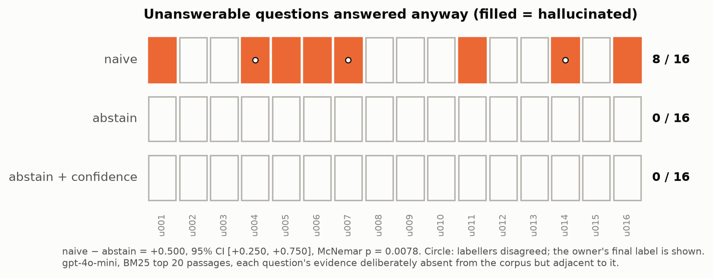
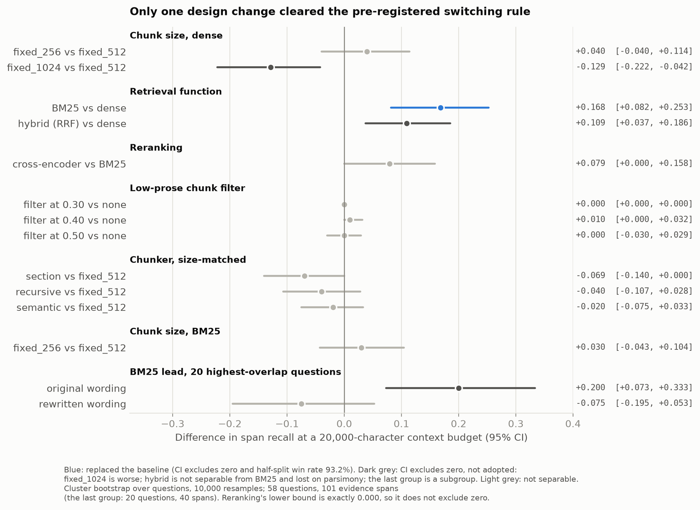
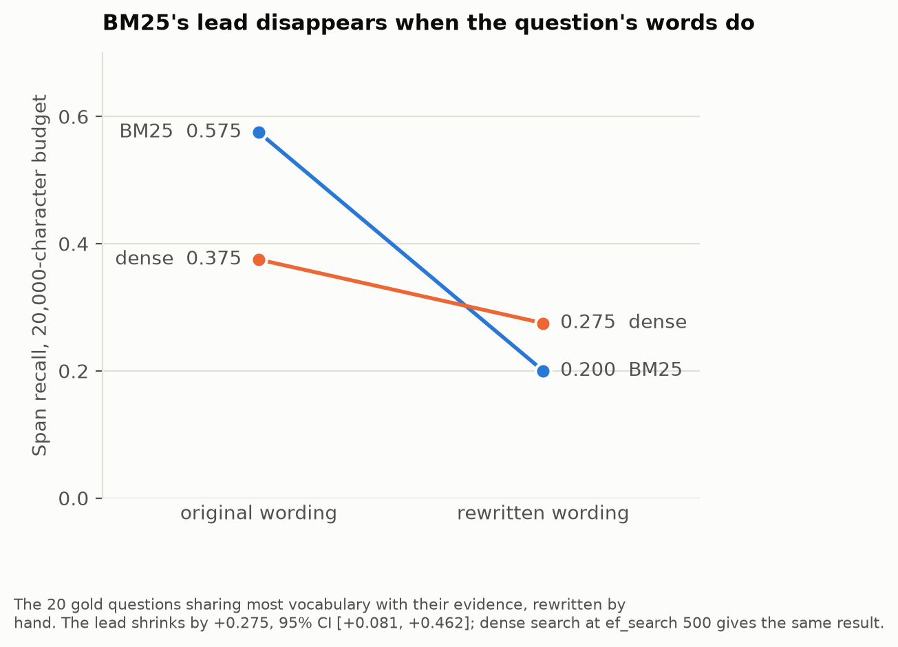
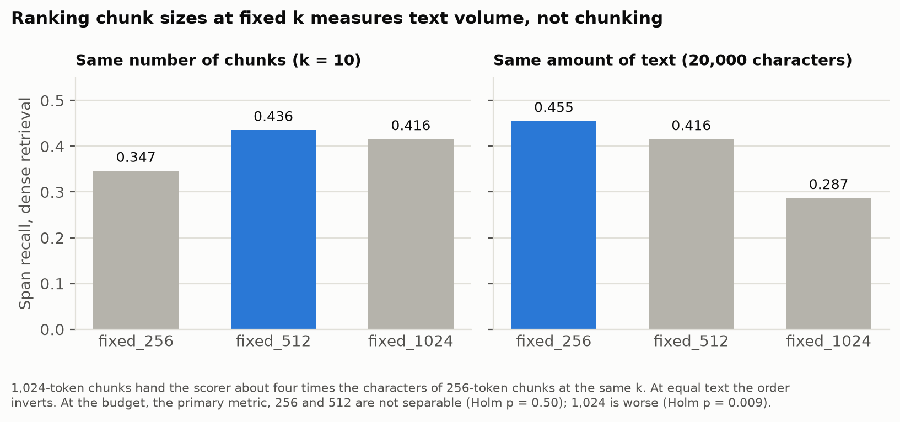
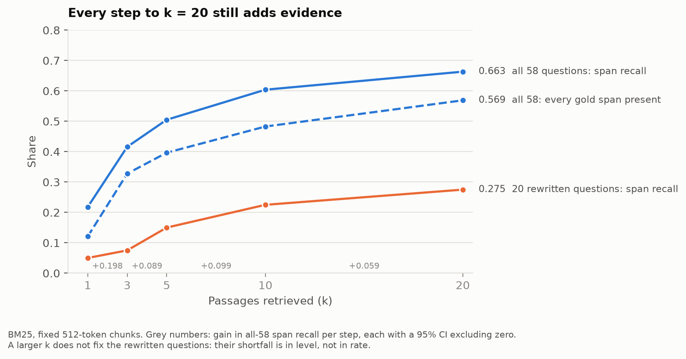

# RAG Evaluation Lab

Measured findings about which design decisions in a retrieval-augmented
generation (RAG) system change retrieval quality and answer faithfulness.
The deliverable is the findings, not the system: the pipeline is the
apparatus that produced them. From the paraphrase test onward, each
decision rule was committed as its own protocol before the run it
governed (seven in `docs/`). Earlier ones were not: the switching rule was
first written down alongside sweep 1's result and applied from sweep 2,
and the fusion runs were exploratory. Every result table is in
`results/tables/`, and every table carries a provenance row (the command,
git commit and gold-set hash that wrote it).

**Corpus:** 130 arXiv papers on deep-learning weather forecasting (2015
onward). **Gold set:** 74 hand-built questions (20 factual, 14
comparative, 18 multi-hop, 6 ambiguous, 16 deliberately unanswerable),
with 101 evidence spans anchored to exact character offsets in the
extracted text, across 33 papers; the other 97 papers are distractors.

---

## Headline: an abstention instruction removed hallucination on unanswerable questions



Given the 20 best BM25 passages and a question whose answer is not in the
corpus, gpt-4o-mini answered anyway on **8 of 16** questions with a plain
prompt, and on **0 of 16** when told to say so if the context did not
contain the answer. The difference is **+0.500, 95% CI [+0.250, +0.750]**,
McNemar p = 0.0078 (Holm-corrected 0.0156). The instruction cost nothing
measurable: no strategy refused any of the 33 questions whose evidence was
fully retrieved. Adding a stated-confidence line changed nothing.

**Why it showed up at all.** An early test found the model refusing a
trivially unanswerable question, and the risk register flagged that this
headline might measure nothing. The unanswerable questions were therefore
built to be **adjacent, not absent**: right domain, right vocabulary,
only the specific fact missing, absence verified by corpus-wide search.
For example, WeatherBench 2 reports SEEPS scores and covers FuXi, but
never gives FuXi a SEEPS score. That is exactly where the plain prompt
fails. It says the fact is not there, then answers the neighbouring
question instead. With trivially absent questions the result would very
likely have read 0/16 against 0/16. **The design of the question set
matters more than the number.**

**Stated confidence carries almost no information.** Asked to rate its
confidence, the model said "high" on 97% of answers with complete
evidence and 92% of answers with part of the evidence missing.

Read the limits before quoting this result (below): 16 questions, one
model, one corpus, and three of the 48 labels were disputed.

---

## Retrieval: what moved, and what didn't



Span recall is the share of gold evidence spans that appear in the
retrieved text. The primary metric fixes the **amount of text** retrieved
(20,000 characters) rather than the number of chunks, because chunk counts
are not comparable across chunk sizes (see the chunk-size finding below).
A change replaced the baseline only if its paired 95% CI excluded zero
**and** it won decisively across random half-splits of the gold set.

| comparison (20k budget) | delta | 95% CI | outcome |
|---|---|---|---|
| BM25 vs dense (all-MiniLM-L6-v2) | **+0.168** | [+0.082, +0.253] | **BM25 replaced dense** (Holm p 0.0069, 93.2% of half-splits) |
| hybrid (RRF) vs dense | +0.109 | [+0.037, +0.186] | not separable from BM25 (−0.059 [−0.141, +0.020]); BM25 kept as simpler |
| cross-encoder rerank vs BM25 | +0.079 | [0.000, +0.158] | not separable: lower bound exactly zero |
| fixed_256 vs fixed_512 chunks, dense | +0.040 | [−0.040, +0.114] | not separable |
| fixed_1024 vs fixed_512, dense | −0.129 | [−0.222, −0.042] | worse |
| fixed_256 vs fixed_512, BM25 | +0.030 | [−0.043, +0.104] | not separable; interaction with retriever ≈ 0 |
| section / recursive / semantic chunkers vs fixed_512 | −0.069 / −0.040 / −0.020 | all include zero | not separable, all below fixed windows |
| drop low-prose chunks (0.3 / 0.4 / 0.5) | +0.000 / +0.010 / +0.000 | all include zero | not separable |

**Final configuration:** BM25 over fixed 512-token chunks, no fusion, no
reranking, no filter, 20 passages to the generator.

### BM25's lead is mostly an artifact of how the questions were written



Every gold question was written while reading its evidence, which hands a
lexical retriever the author's exact words. The 20 questions sharing most
vocabulary with their evidence were rewritten by hand to ask the same
thing in different words, and both retrievers were re-scored. BM25's lead
on those questions fell by **+0.275 [+0.081, +0.462]**, to −0.075
[−0.195, +0.053]: no detectable advantage. So the headline retrieval
number, BM25 +0.168 over dense, is real on this gold set but **inflated
by authoring**. On questions phrased the way an unfamiliar user would ask
them, this gold set cannot tell the two apart. BM25 stays the baseline,
but the explanation for why it wins has changed.

### Chunk size at fixed k measures text volume, not chunking



At the same k, 1,024-token chunks hand the scorer about four times the
text of 256-token chunks, so "bigger chunks retrieve better" at fixed k is
partly "more text retrieves better". At an equal character budget the
ranking inverts. The inversion held across 4,000 random half-splits.
Comparisons that change chunk size should fix the budget, not k.

### More passages kept helping, up to 20



Each step on the ladder 1 → 3 → 5 → 10 → 20 added evidence with a CI
excluding zero, so the generator gets k = 20, the top of the ladder
rather than a measured plateau. Even then, only 57% of questions have
every gold span in context. Every answerable-question result is therefore
split by whether the evidence was complete, so a missing passage is never
read as a generation failure.

### Smaller findings

- **Fusion trades slots; it does not add them.** Reciprocal rank fusion at
  its usual constant (k = 60) ranks almost purely by agreement: 100% of the
  fused top 10 came from documents both retrievers found. Lowering the
  constant raises the unique share (0%, 9%, 15%), but every arm landed
  within 0.663–0.683, and plain interleaving, which has no constant to
  tune, scored exactly BM25's number.
- **Figure axis labels dominate dense retrieval** for metric-name queries.
  Under BM25 they hold at most 2.2% of top-10 slots, so filtering them does
  nothing there.
- **"Unreachable" questions were ordering failures.** Two questions every
  first-stage retriever missed had their evidence inside BM25's top 100 all
  along; the reranker recovered one fully and one partly.
- **Reranking completes two-span questions rather than reaching new
  ones**: both spans present for 19 of 33 two-span questions, against 11
  without it (exploratory).

---

## Limitations

These bound every claim above.

- **Small samples.** 58 scorable questions and 101 spans. Detecting a
  four-point difference in span recall at 80% power would need about 8×
  the spans, around 450–500 questions. Most nulls here mean "smaller than
  this gold set can see", not "no effect". The hallucination result rests
  on 16 questions; its direction is established, its size is not (±0.25).
- **The hallucination result depends on three disputed labels.** Labels
  were assigned blind to strategy, first by Claude and then by the owner,
  whose label is final. All three disagreements are plain-prompt answers
  that refuse and then answer anyway, labelled hallucination by the owner.
  Reversed, the count is 5/16: the pre-registered interval still excludes
  zero ([+0.125, +0.563]), but McNemar p = 0.0625 (Holm 0.125). **The
  direction survives; the significance does not.** The owner's review
  showed Claude's labels, so 45/48 agreement is not agreement between
  independent labellers.
- **A defect in the pre-registered decision rule.** With one arm at 0/16,
  a percentile bootstrap on the difference cannot go negative, so the rule
  reduced to "the plain prompt hallucinates on at least 4 of 16". The rule
  was honoured as written. The exact McNemar test is reported alongside
  it, and at the recorded 8/16 both agree.
- **Authoring confound.** Retrieval scores are measured on questions
  written by people who had read the evidence (above). Absolute recall
  numbers will be optimistic for real users.
- **One corpus, one generator, one wording per prompt, one sample per
  answer.** gpt-4o-mini at temperature 0 was not fully deterministic: the
  same answer repeated word for word in only 2 to 4 of 5 trials.
  Faithfulness was scored by a single judge (gpt-4o, test-retest noise
  0.083), so differences below that are not interpretable.
- **The scoring rule favours fixed windows.** Any-overlap span scoring
  gives a span cut in two a second chance. Fixed windows cut 62 of 101
  gold spans, structure-aware chunkers 26–38. A post-hoc check suggests
  this does not explain the chunkers' deficit, but it biases that
  comparison.
- **Gold-set defects found and kept.** The gold set was closed before the
  sweeps, so known defects are recorded, not fixed. c006's spans cover
  only half its reference answer. c008's reference answer confuses one
  paper's baseline with its ground truth. Several other questions were
  caught and fixed before closure after validating cleanly while not
  supporting their answers ("valid but wrong" evidence). Mechanical
  validation cannot catch this class.
- **Reproducibility, measured rather than assumed.** Retrieval results
  reproduce exactly from the frozen extraction. On 31 October 2026 a fresh
  clone with its own environment re-downloaded all 130 papers at their
  recorded arXiv versions and extracted them twice. The two runs were
  byte-identical to each other, and both were byte-identical to the frozen
  extraction for **130 of 130** papers, the PDFs included. All 101 gold
  spans selected the same text, and the rebuilt index reproduced 11
  retrieval tables cell for cell: nine BM25 tables and two dense tables at
  ef_search 500. The extracted text is not redistributed, for licensing
  reasons (arXiv's default licence does not permit third parties to
  redistribute papers). So a clone regenerates it and checks it against
  committed SHA256 hashes (`data/eval/interim_sha256.csv`). This holds
  while arXiv keeps serving those exact versions and PyMuPDF stays at
  1.28.2.
- **Dense tables written before 31 October vary below the top of the
  ranking; the current configuration does not.** Those tables were
  searched at Chroma's default HNSW depth (ef_search 100), which is
  approximate and varies between processes. Across three processes the top
  10 matched for all 58 questions, except one batch that swapped ranks 9
  and 10 for one question. Deeper down, the order diverged more: the top 50
  matched for only 40–43 questions. Gold spans found never changed at
  k ≤ 30, and every span-recall column was identical in every re-run, but
  first-hit rank, MRR and deep ranks in those tables are not exactly
  reproducible. At the declared ef_search of 500, search is exact. Phase 9
  rebuilt the index in a fresh clone, embedded everything from scratch on
  the GPU, and reproduced both current dense tables with **0 differing
  cells**.
- **The embedding model sees only part of each chunk.** all-MiniLM-L6-v2
  reads 256 word pieces, so about 53% of chunk text never reaches it. This
  caps the dense ceiling. Most dense misses had their evidence fully
  visible, so it does not explain them.
- **Scope.** Four chunking strategies were tested (fixed windows at three
  sizes, section-aware, recursive, semantic), not the six planned. An
  embedding-model sweep was dropped once dense retrieval left the
  pipeline. Citation precision (0.34–0.39) counts only citations of
  gold-evidence chunks as correct, so it is a lower bound.

---

## Reproducing

Every step below was run from a fresh clone on 31 October 2026 (Phase 9).

```powershell
git clone <repo> C:\rag-lab        # a short path: deep paths exceed Windows' 260-character limit
cd C:\rag-lab
python -m venv .venv
.venv\Scripts\activate
pip install -r requirements.lock.txt
python -m pytest -q

# corpus and extraction (about 10 minutes, mostly polite pauses between downloads)
python scripts\01_fetch_corpus.py --from-manifest
python scripts\02_extract_text.py --compare 0
python scripts\30_extraction_hashes.py --check data\interim --raw data\raw
python scripts\08_validate_gold.py

# index, then any retrieval table
python scripts\03_build_index.py --config baseline.yaml
python scripts\10_eval_retrieval.py --config sweep_bm25.yaml --tag bm25 --k-max 50
```

The lockfile installs torch 2.11.0 with CUDA 12.8 (needed for the RTX
50-series). `--from-manifest` downloads the recorded paper versions; it
never searches arXiv, because a search today returns a different corpus.
Use the virtual environment created inside the clone. The package
resolves its data directories from where it is installed, so another
checkout's environment would write into that checkout. The command each
table was written with is in `results/tables/provenance.csv`.

**From the committed tables, with no corpus, index or API key:** every
statistic and figure. Half-split stability, paired tests and the
pre-registered result scripts (`15`, `16`, `19`–`22`, `24`, `25`, `28`)
read only `results/tables/`, and each was re-run and reproduced its
committed tables exactly. `13` and `14` print comparisons from the same
tables, and `29_figures.py` draws the figures from them.

**Retrieval runs** need the corpus, the extraction and a Chroma index
(the commands above). Gold evidence is anchored to exact character
offsets in the extraction. `30_extraction_hashes.py --check` confirms a
regenerated extraction matches the frozen one before anything is scored.

**Generation** (`26_generate.py`) needs an OpenAI key; model versions are
pinned to dated snapshots.

`results/tables/provenance.csv` records, for each table, the command that
wrote it, the commit, whether the tree was dirty, and the gold-set hash.
Tables written before that ledger existed carry `unknown` wherever the
fact is not on record; nothing is inferred.

---

## Where things are

| | |
|---|---|
| `docs/build-log.md` | the full record: every sweep, its pre-registered predictions and how they landed, defects found, standing lessons |
| `docs/*-protocol.md` | the pre-registrations, each committed before its run |
| `data/eval/` | the gold set and the paraphrased questions |
| `results/tables/` | every result table, and the provenance ledger |
| `results/figures/` | the figures above (`scripts/29_figures.py`) |
| `scripts/` | numbered pipeline steps; `10_eval_retrieval.py` is the one scoring harness every retrieval arm goes through |
| `src/rageval/` | the package: chunking, embedding, retrieval, generation, evaluation |

MIT licence.
